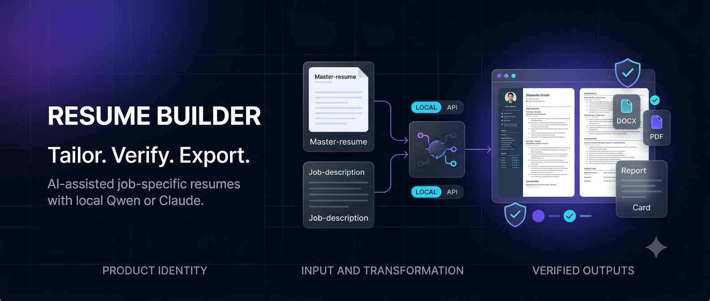

<div align="center">



# 📄 Resume Builder

**Tailor your resume to any job in seconds — locally or with 100+ LLMs.**

[](https://www.python.org/)
[](https://docs.litellm.ai/docs/providers)
[](https://ollama.com/)
[](https://www.anthropic.com/)
[](#-windows--the-easiest-way)
[](LICENSE)

### 🌐 [Launch Resume Studio → resume-studio-in.vercel.app](https://resume-studio-in.vercel.app)

[](https://resume-studio-in.vercel.app)
[](https://vercel.com/new/clone?repository-url=https%3A%2F%2Fgithub.com%2FDwaipayanDutta%2Fresume_builder&project-name=resume-studio-in&repository-name=resume-studio-in)

[Live app](https://resume-studio-in.vercel.app) •
[Deploy](#-deploy-to-vercel) •
[Quick start](#-windows--the-easiest-way) •
[How it works](#-how-it-works) •
[CLI](#-command-line) •
[Input format](#-prepare-your-inputs) •
[Outputs](#-output-files) •
[Layout](#-repo-layout) •
[Troubleshooting](#-troubleshooting)

</div>

---

## ✨ Overview

Resume Builder tailors your resume to a job using the bundled prompt
([`prompt_template.txt`](src/resume_builder/prompt_template.txt)), then builds a polished
2-page **`Resume.docx`** and **`Resume.pdf`** with the original `create_resume.py` (unchanged).

Powered by **[LiteLLM](https://docs.litellm.ai/docs/providers)** (OpenAI, Gemini, Groq,
Mistral, Bedrock, …) plus built-in **Ollama** and **Claude** backends.

| 🎯 Tailored | 🔒 Private | 🌐 Flexible | 📄 Polished |
|:-----------:|:----------:|:-----------:|:-----------:|
| Matches your resume to the job description | Run fully offline with a local model | 100+ LLM providers | 2-page DOCX + PDF output |

### 🔄 How it works

1. Provide a structured plain-text resume and the target job description.
2. Choose local Qwen, Claude, or a provider supported by LiteLLM to tailor the content.
3. Review the tailored text and fit report; employer and date differences are flagged.
4. Export the resume as DOCX and PDF, with optional output verification.

| Backend | Internet needed | API key | Data processing |
|---------|:---------------:|:-------:|-----------------|
| 🧠 **Qwen via Ollama** | Model download only | No | Local after setup |
| 🤖 **Claude** | Yes | Anthropic key | Sent to Anthropic's API |
| 🌐 **LiteLLM provider** | Usually | Provider-dependent | Sent to the selected provider |
| 📝 **Format only** | No | No | Local |

---

## 🖥️ Windows — the easiest way

> Just want to run it? **Double-click `run_resume.bat`.** That's it.

You'll get a menu:

| # | Option | What it does | Needs |
|:-:|--------|--------------|-------|
| **1** | 🧠 **Local Qwen 2.5 3B** | Installs Ollama via winget and downloads the model (~2 GB, one time). Fully offline, fully private. | Nothing |
| **2** | 🌐 **Any provider (LiteLLM)** | Claude (Anthropic), Gemini, OpenAI, Groq, Mistral, OpenRouter, Together, DeepSeek, xAI, Azure, Fireworks, Perplexity, HuggingFace, Replicate… Your key is used for this run only, never written to disk. LiteLLM is installed on first use. | Provider API key |
| **3** | 📝 **Format only** | Just re-renders your existing TXT into `.docx` / `.pdf`. No AI, no key, no cost. | Nothing |
| **4** | 🖥️ **Web app** | Opens **Resume Studio** in your browser: upload your `.txt`, paste a job link (or the description), tailor or format, then preview and download the PDF/Word. You first pick the AI (same choices as 1–3). | Nothing extra; Node.js is installed via winget once to build the UI |

#### 🖥️ Option 4: the web app

Available in both `run_resume.bat` and `run_resume_comprehensive.bat`.

1. Pick option **4**, then choose the AI to use (local Qwen, any provider such as Claude, or none).
   Keys are entered in the console window and stay in that window's memory only.
2. The first run installs the web libraries (`pip install ".[web]"`), installs Node.js with winget
   if needed, and builds the interface (about a minute). Later runs start in seconds.
3. Your browser opens at `http://127.0.0.1:8001/` (the next free port if 8001 is busy). The server
   only listens on your own computer.
4. On the **Dashboard**: upload your resume `.txt`, paste the job posting link and click
   **Fetch job** (or paste the description), choose **Tailor with AI** or **Format only**, then
   **Build**. Preview the PDF in the page and download **PDF**, **Word** or the tailored **TXT**.
5. Keep the console window open while you use the app; close it to stop the server.

Job links are read with the posting's structured data when the site provides it. Sites that need a
sign-in (for example LinkedIn) can't be read; paste the description instead.

### 🔑 How option 2 (any provider, including Claude) works

When you choose **2**, the script asks for your credentials in the form `provider:key`:

```text
provider:key: gemini:AIzaSy...your-key...
Credentials accepted for provider: gemini (env: GEMINI_API_KEY)
```

It then asks for a LiteLLM **model string**, prefixed with the provider:

```text
Model: gemini/gemini-2.5-flash
```

Common examples:

| Provider | Credentials prompt | Model string |
|----------|--------------------|--------------|
| **Claude (Anthropic)** | `anthropic:sk-ant-…` | `anthropic/claude-sonnet-5-5` |
| **Gemini** | `gemini:AIzaSy…` | `gemini/gemini-2.5-flash` |
| **OpenAI** | `openai:sk-…` | `openai/gpt-4o` |
| **Groq** | `groq:gsk_…` | `groq/llama-3.3-70b-versatile` |
| **Mistral** | `mistral:…` | `mistral/mistral-large-latest` |
| **OpenRouter** | `openrouter:sk-or-…` | `openrouter/anthropic/claude-3.5-sonnet` |

Supported provider names: `openai`, `anthropic` / `claude`, `gemini` / `google`, `groq`,
`mistral`, `cohere`, `openrouter`, `together`, `deepseek`, `xai`, `azure`, `fireworks`,
`perplexity`, `huggingface`, `replicate`. To add another, edit `:map_provider_env` inside
`run_resume.bat` — one line per provider.

<details>
<summary><b>⚠️ <code>.bat</code> file gotcha (one-time, 10 seconds)</b></summary>

<br>

If you get **`The system cannot find the batch label specified`** when you double-click,
your editor saved the file with **LF (Unix) line endings**. `cmd.exe` can't resolve
`goto :label` in LF-only `.bat` files. Fix:

- **VS Code:** click `LF` in the bottom-right corner → choose **`CRLF`** → save (`Ctrl+S`).
- **Notepad:** File → Save As → Encoding **ANSI** (modern Notepad preserves CRLF).
- **Notepad++:** Edit → EOL Conversion → **Windows (CR LF)** → save.

That's it — no other setup needed.

</details>

---

## 💻 Command line

### 📥 Install

```bash
# Lightweight core: docx, reportlab, pypdf only
pip install .

# Or with the AI extra: adds LiteLLM for 100+ providers
pip install ".[ai]"
```

> **Why `.[ai]`?** The base package stays minimal — zero heavy dependencies for people who
> only need to format a resume or use the built-in Ollama/Claude backends. Adding `[ai]`
> pulls in `litellm` and its client libraries to unlock 100+ LLMs.

### 🚀 Tailor a resume

```bash
# Local, free, private (Ollama + Qwen 2.5 3B)
tailor-resume "examples/New Resume.txt" \
  --job-title "Senior Program Manager" \
  --company   "Acme" \
  --jd        job.txt \
  --backend   qwen \
  -o out --verify

# Claude API
tailor-resume "examples/New Resume.txt" \
  --job-title "Senior Program Manager" \
  --jd        job.txt \
  --backend   claude \
  -o out --verify

# Any provider via LiteLLM
tailor-resume "examples/New Resume.txt" \
  --job-title "AI Engineer" \
  --jd        job.txt \
  --backend   litellm \
  --model     gemini/gemini-2.5-flash \
  -o out --verify
```

### 📝 Format only (no AI)

```bash
create-resume resume.txt -o out --verify
```

### 🌐 LiteLLM backends

The `--backend litellm` path reads the provider's API key from your environment
(or you can set it inline for a single run):

```bash
# export OPENAI_API_KEY="sk-..."
# export GEMINI_API_KEY="..."
# export GROQ_API_KEY="gsk_..."

tailor-resume resume.txt --job-title "AI Engineer" --jd job.txt \
  --backend litellm --model openai/gpt-4o                    -o out --verify
tailor-resume resume.txt --job-title "AI Engineer" --jd job.txt \
  --backend litellm --model gemini/gemini-2.5-flash          -o out --verify
tailor-resume resume.txt --job-title "AI Engineer" --jd job.txt \
  --backend litellm --model groq/llama-3.3-70b-versatile     -o out --verify
tailor-resume resume.txt --job-title "AI Engineer" --jd job.txt \
  --backend litellm --model ollama/qwen2.5:3b                -o out --verify
```

See the full [LiteLLM provider list](https://docs.litellm.ai/docs/providers) for every
supported model string.

---

## 🎨 Full-Stack Guided Web Editor & API

The repository includes a modern full-stack guided resume editor featuring a React + TypeScript frontend and a FastAPI backend with live debounced A4 preview, contextual AI bullet enhancement, and heuristic ATS checklists.

### 📥 Install Web Dependencies

The core CLI remains ultra-lightweight. Web and rendering dependencies are completely optional:

```bash
# Install web dependencies (FastAPI, Uvicorn, Jinja2, WeasyPrint, Mammoth)
pip install ".[web]"

# Optional: Claude backend for the web API (uses the official anthropic SDK)
pip install ".[web,claude]"

# Or install all optional dependencies (LiteLLM + Claude + Web)
pip install ".[all]"
```

> **PDF rendering / page count:** WeasyPrint needs the native Pango libraries. On Linux/macOS install
> them with your package manager (`apt install libpango-1.0-0 libpangoft2-1.0-0` / `brew install pango`);
> on Windows install the GTK3 runtime (MSYS2 `pacman -S mingw-w64-x86_64-pango`) and put its `bin`
> on `PATH`. Without them the editor still shows the HTML preview and exports DOCX, but PDF export
> fails with an explicit error and the page count is shown as **unavailable** (it is never estimated).

### 🚀 Running the Web Editor

**One command (what `run_resume.bat` option 4 does):** build the UI once, then start the
server, which serves both the API and the UI on one local port and opens your browser:

```bash
cd web && npm install && npm run build && cd ..
resume-studio            # or: python -m resume_builder.webapp  [--port 8001] [--no-browser]
```

Set `RESUME_BACKEND` (`qwen`, `claude` or `litellm`) and `RESUME_MODEL` beforehand to preselect
the AI in the Dashboard, plus the provider's key variable (e.g. `ANTHROPIC_API_KEY`).

**For frontend development (hot reload)**, in one terminal start the Python API service:

```bash
uvicorn resume_builder.api.main:app --reload --port 8001
```

In a second terminal, start the Vite frontend (requires Node.js 18+). The dev server runs on port
5175 and proxies `/api` to `http://127.0.0.1:8001`:

```bash
cd web
npm install
npm run dev
```

Open your browser at `http://localhost:5175`.

### 🔐 Accounts

Visitors first see a **welcome page** (features, how it works, privacy). From there the web app
asks people to **create an account and sign in** before they can use it. Every `/api/*` endpoint
except `/api/auth/*` requires a session.

- **Where accounts live:** locally, a SQLite file at `~/.resume_studio/studio.db` (set
  `RESUME_DB_PATH` to move it). When `DATABASE_URL` or `POSTGRES_URL` is set (as on Vercel), a
  PostgreSQL database is used instead (`pip install ".[postgres]"`).
- **Security:** passwords are salted **scrypt** hashes; sessions are random tokens in an HttpOnly,
  SameSite=Lax cookie (marked `Secure` over HTTPS) that lasts 30 days, and the database stores only
  a SHA-256 of each token. Signing in is throttled after 5 failed attempts per email for 15 minutes.
- **Resume files are never stored:** each build runs in a temporary folder that is deleted before
  the response is sent, and the PDF/Word/TXT come back inside the response.
- To reset a local install (all accounts and sessions), stop the app and delete `studio.db`.

### 🔀 Backend selection (web API)

The Dashboard (`/api/studio/*`) uses the same pipeline as `tailor-resume`, so it uses that CLI's
backend names: `qwen` (Ollama), `claude` and `litellm`. Its endpoints are `GET /api/studio/config`,
`POST /api/studio/jd-from-url` and `POST /api/studio/build` (which returns the files in its
response). On a hosted deployment the local `qwen` option is hidden.

In the guided editor, AI is only used by `POST /api/tailor` and `POST /api/enhance-bullet`; the
request's `backend` field picks one of:

| `backend` | Where data goes | Credentials (server-side env vars only) |
|-----------|-----------------|-----------------------------------------|
| `ollama` (default) | Local Ollama at `http://localhost:11434` | none |
| `claude` | Anthropic API | `ANTHROPIC_API_KEY` |
| `litellm` | Provider chosen by `model` (e.g. `gpt-4o`, `gemini/…`) | provider's usual env var, e.g. `OPENAI_API_KEY` |

API keys are **never** accepted from the browser; set them in the environment of the `uvicorn`
process. Preview (`/api/render/preview`) and export (`/api/render/pdf`, `/api/render/docx`) are
format-only and never call an AI backend.

### 🧪 Tests

```bash
pip install ".[web,test]"
pytest                      # Python API/model tests (real-PDF tests skip if Pango is missing)

cd web
npm test                    # Vitest: store, schemas, preview, enhance, ATS, sections
npm run typecheck
npm run build
```

### 🌟 Key Web Editor Capabilities

1. **Section Management & Undo/Redo:**
   - Guided forms for Contact Info, Summary, Work Experience, Projects, Education, Skills, and Certifications.
   - Drag-and-drop section reordering and bullet point reordering with deep undo/redo history.
2. **Real-Time Split-Pane Preview:**
   - True A4 page rendering via Jinja2 HTML templates (auto-escaped) and the WeasyPrint layout engine, shown in a fully sandboxed iframe.
   - Debounced updates with automatic stale-request cancellation (`AbortController`).
   - Page-count badge reporting exact rendered pages (highlighting >2 pages).
3. **Contextual Bullet Enhancement (Inline AI):**
   - Click `✨` alongside any bullet point to refine it against the target job description.
   - Sends only the selected bullet and job-description context to the backend.
   - Returns 2–3 action-oriented variations; any variation containing a number not present in the original bullet is discarded server-side.
   - Server-side key management and explicit cloud disclosure before sending data to Claude or LiteLLM.
   - User must explicitly accept or reject variations before updating state.
4. **ATS Alignment & Heuristic Checklist:**
   - Real-time keyword extraction matching the job description against resume skills and experience.
   - Accurate page-count limits (using actual rendered PDF page counts, not character approximations).
   - Action verb heuristic checks and unresolved `[ADD METRIC]` placeholder warnings.
   - Transparently documented as heuristics, not ATS guarantees. Critical labels are strictly reserved for requirements explicitly marked mandatory in the job description.
5. **Export & Import:**
   - Single-click export to high-fidelity PDF and Word (`.docx`).
   - Existing `.docx` resume import.

---

## 🚀 Deploy to Vercel

The live app runs at **[resume-studio-in.vercel.app](https://resume-studio-in.vercel.app)**. The repo is ready for Vercel:
`vercel.json` builds the web UI as static files and runs the FastAPI backend as a Python function
(`api/index.py`, dependencies in `requirements.txt`, about 65 MB of Vercel's 250 MB function limit).

**One-time setup (about 5 minutes):**

1. Sign in at [vercel.com](https://vercel.com) with GitHub, then **Add New → Project** and import
   `DwaipayanDutta/resume_builder` (or click the **Deploy with Vercel** button above).
   Name the project **`resume-studio-in`** so the address matches the link above.
2. Leave the build settings as they are (they come from `vercel.json`) and click **Deploy**.
3. Accounts need a database: open the project's **Storage** tab, add a **Neon (Postgres)**
   database and connect it to the project. This sets `DATABASE_URL` automatically. Then
   **Redeploy**. Until this is done, registering shows a message asking for the database.
4. Optional, AI tailoring: under **Settings → Environment Variables** add `ANTHROPIC_API_KEY`
   and `RESUME_BACKEND=claude` (optionally `RESUME_MODEL`, default `claude-sonnet-5-5`), then
   redeploy. Without a key the site works in **Format only** mode.

> ⚠️ **AI costs:** anyone who registers on the public site can use the AI key you configure, and
> the provider bills you. Set a spending limit with your AI provider before adding a key.

**Custom domain:** once `resume-studio.in` is active at your registrar, add it under
**Settings → Domains** in Vercel and create the DNS records Vercel shows you.

**Differences from running it locally:**

| Feature | Local (`run_resume.bat`) | Vercel |
|---------|--------------------------|--------|
| Dashboard: upload TXT, job link, PDF/Word download | ✅ | ✅ |
| AI tailoring | Local Qwen, or any provider via LiteLLM | Claude via your key (LiteLLM is too large for a Vercel function) |
| Accounts | SQLite file on your computer | Postgres (Neon) |
| Guided editor PDF export / page count | ✅ with WeasyPrint + Pango | ❌ (needs native libraries); use the Dashboard for PDFs |
| Long AI runs | No limit | Up to 60 s per request (`maxDuration` in `vercel.json`; raise to 300 once Fluid compute is enabled in the project settings) |

---

## 🎨 Brand assets

Logo files live in [`assets/brand/`](assets/brand/):

| File | Use |
|------|-----|
| `resume-studio-icon.svg` | Standalone icon, transparent background (also the favicon) |
| `resume-studio-logo-on-dark.svg` / `-on-light.svg` | Horizontal lockup for dark / light backgrounds |
| `resume-studio-app-icon.svg` / `resume-studio-app-icon-1024.png` | 1024 × 1024 application icon |

The icon is a document with a folded corner and an **R** whose leg becomes a verification
checkmark, plus a teal AI sparkle. It is designed on a 64-unit grid so it stays legible at
32 × 32 px. The wordmark is outlined Poppins SemiBold (SIL Open Font License). To regenerate the
files, run `assets/brand/source/make_brand.py` (see its docstring).

---

## 🗂️ Prepare your inputs

### Resume

Use a `.txt` resume with the same structure as [`examples/New Resume.txt`](examples/New%20Resume.txt):

- Put your name and headline on the first two lines, followed by contact details.
- Give each section an uppercase heading followed by a line of `=` characters.
- Keep each work-history entry in the order: job title, company, `MM/YYYY - MM/YYYY` (or `MM/YYYY - Present`), location, then bullets.
- Keep the original employers and dates accurate. The tool warns about detected differences, but you should still review the result manually.

### Job description

Pass the job description as a plain-text file with `--jd`, or provide its text with `--jd-text`.
Include the responsibilities and qualifications you want the tailoring step to consider.

> 🔐 Use sample or anonymized personal information in public examples. Keep generated resumes and reports out of version control.

---

## 📦 Output files

| File | Description |
|------|-------------|
| 📝 `Resume.txt` | Tailored plain-text resume |
| 📄 `Resume.docx` | 2-page Word document (via `create_resume.py`) |
| 📕 `Resume.pdf` | 2-page PDF (via `create_resume.py`) |
| 📊 `Resume_report.md` | Fit rating, keyword table, metric questions, LinkedIn "About", bullet variations |
| 🔍 `Resume_raw.txt` | The model's raw reply — for debugging |

### ✅ After tailoring — check the warnings

- 📐 **Layout** — your input TXT must use the same layout as `examples/New Resume.txt`.
- 🕵️ **Employer / date mismatches** — the tool flags any employer or date that differs from your original.
- ✏️ **`[ADD METRIC]` placeholders** — the tool leaves these where you should add a concrete number. Fill them in before sending the resume out.

---

## 🛡️ Privacy and responsible use

- **Local mode:** With Ollama, resume and job-description content is processed by the local model after the model has been downloaded.
- **Cloud modes:** Claude and LiteLLM send the prompt, including resume and job-description text, to the selected API provider. Review that provider's data-handling terms before use.
- **API keys:** The Windows launcher accepts keys for the current run. When using the CLI, prefer environment variables or `--api-key`; do not commit keys to source control. The web API only reads keys from server-side environment variables.
- **Web editor:** Editing, preview, and export run entirely against your local API. Only the **✨ Enhance** action (and `/api/tailor`) contacts an AI backend; the enhance dialog states before sending whether the text stays local (Ollama) or goes to a cloud provider (Claude/LiteLLM).
- **Hosted site:** on the Vercel deployment your TXT is uploaded to the server to build the files, which are returned to you and never stored. Accounts (name, email, password hash) are kept in the project's database.
- **Job links:** "Fetch job" downloads that one page from the job site, from the server running Resume Studio. Only public http(s) pages are fetched; local/private network addresses are refused.
- **Review every result:** Automated checks can flag certain employer/date changes and metric placeholders, but cannot guarantee the truth or quality of generated content. Confirm all facts, dates, credentials, and metrics before using a resume.

This tool assists with tailoring and document generation; it does not guarantee ATS compatibility, interviews, or employment outcomes.

---

## 🧩 Repo layout

```text
resume_builder/
├─ assets/
│  └─ banner.png                   ← README banner
├─ api/index.py                    ← Vercel entry point for the FastAPI app
├─ vercel.json                     ← Vercel build + routing config
├─ requirements.txt                ← Python dependencies for the Vercel function
├─ run_resume.bat                  ← Windows launcher (double-click)
├─ run_resume_comprehensive.bat    ← Alternate Windows launcher
├─ pyproject.toml
├─ examples/
│  └─ New Resume.txt               ← Sample input — match this layout
├─ src/resume_builder/
│  ├─ create_resume.py             ← `create-resume` CLI (TXT → DOCX + PDF)
│  ├─ tailor.py                    ← `tailor-resume` CLI
│  ├─ webapp.py                    ← `resume-studio` launcher (API + built UI, opens browser)
│  ├─ prompt_template.txt          ← The tailoring prompt
│  ├─ models/resume.py             ← Pydantic ResumeData schema (web layer)
│  ├─ ai/                          ← Web backends (Ollama, Claude, LiteLLM) + orchestrator
│  ├─ verification/fact_checker.py ← Flags invented metrics in AI output
│  ├─ rendering/                   ← Jinja2 HTML/PDF + DOCX renderers, templates/
│  └─ api/                         ← FastAPI app: main.py (editor API), studio.py (Dashboard API)
├─ tests/                          ← pytest suite for the API and models
└─ web/                            ← React + Vite editor (src/, tests/)
```

---

## ❓ Troubleshooting

| Symptom | Fix |
|---------|-----|
| `The system cannot find the batch label specified` | `.bat` was saved with LF line endings — re-save as CRLF (see gotcha above). |
| `Python was not found on PATH` | Install Python 3 from <https://www.python.org/downloads/> and tick **"Add python.exe to PATH"**. |
| `pyproject.toml was not found` | Extract the whole zip first, then run the `.bat` from inside the extracted folder. |
| `pip install` fails | Check your internet connection, then re-run `run_resume.bat` — it retries the install automatically. |
| Ollama model download fails | Check your internet connection; retry. The model is ~2 GB and only downloads once. |
| `Unknown provider` error | Use one of the names in the provider table, or add it in `:map_provider_env` inside the `.bat`. |
| LiteLLM says "missing API key" | Make sure the `provider:` prefix you typed matches the `--model` prefix (e.g. `gemini:` → `gemini/…`). |

---

## 🤝 Contributing

Contributions and bug reports are welcome. For larger changes, open an issue first to discuss the approach, then submit a pull request with a concise description of the change.

## 🚨 Security

Please do not report security or secret-handling concerns in a public issue. Contact the repository maintainer privately.

---

## 📜 License

See [LICENSE](LICENSE) for details.

<div align="center">

⭐ If this saved you time, consider starring the repo!

</div>
