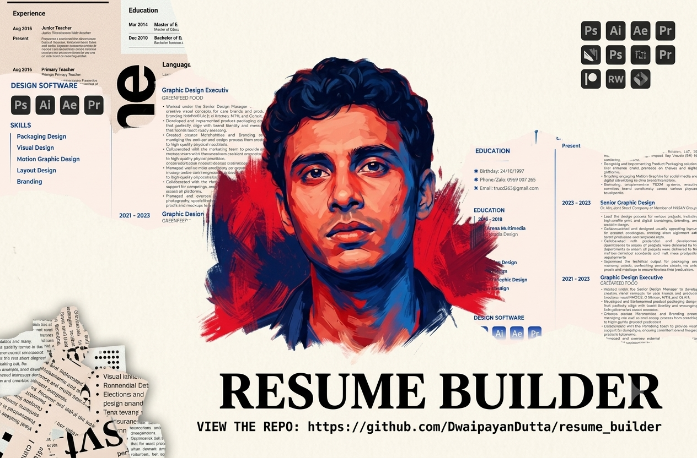

<div align="center">



# 📄 Resume Builder

**Tailor your resume to any job in seconds — locally or with 100+ LLMs.**

[](https://www.python.org/)
[](https://docs.litellm.ai/docs/providers)
[](https://ollama.com/)
[](https://www.anthropic.com/)
[](#-windows--the-easiest-way)
[](LICENSE)

[Quick start](#-windows--the-easiest-way) •
[CLI](#-command-line) •
[Outputs](#-output-files) •
[Layout](#-repo-layout) •
[Troubleshooting](#-troubleshooting)

</div>

---

## ✨ Overview

Resume Builder tailors your resume to a job using the bundled prompt
([`prompt_template.txt`](src/resume_builder/prompt_template.txt)), then builds a polished
2-page **`Resume.docx`** and **`Resume.pdf`** with the original `create_resume.py` (unchanged).

Powered by **[LiteLLM](https://docs.litellm.ai/docs/providers)** (OpenAI, Gemini, Groq,
Mistral, Bedrock, …) plus built-in **Ollama** and **Claude** backends.

| 🎯 Tailored | 🔒 Private | 🌐 Flexible | 📄 Polished |
|:-----------:|:----------:|:-----------:|:-----------:|
| Matches your resume to the job description | Run fully offline with a local model | 100+ LLM providers | 2-page DOCX + PDF output |

---

## 🖥️ Windows — the easiest way

> Just want to run it? **Double-click `run_resume.bat`.** That's it.

You'll get a menu:

| # | Option | What it does | Needs |
|:-:|--------|--------------|-------|
| **1** | 🧠 **Local Qwen 2.5 3B** | Installs Ollama via winget and downloads the model (~2 GB, one time). Fully offline, fully private. | Nothing |
| **2** | 🤖 **Claude API** | Tailors with Anthropic Claude. You paste your `ANTHROPIC_API_KEY` — used for this run only, never written to disk. | Anthropic API key |
| **3** | 🌐 **Any provider (LiteLLM)** | Gemini, OpenAI, Groq, Mistral, OpenRouter, Together, DeepSeek, xAI, Azure, Fireworks, Perplexity, HuggingFace, Replicate… | Provider API key |
| **4** | 📝 **Format only** | Just re-renders your existing TXT into `.docx` / `.pdf`. No AI, no key, no cost. | Nothing |

### 🔑 How option 3 (any provider) works

When you choose **3**, the script asks for your credentials in the form `provider:key`:

```text
provider:key: gemini:AIzaSy...your-key...
Credentials accepted for provider: gemini (env: GEMINI_API_KEY)
```

It then asks for a LiteLLM **model string**, prefixed with the provider:

```text
Model: gemini/gemini-2.5-flash
```

Common examples:

| Provider | Credentials prompt | Model string |
|----------|--------------------|--------------|
| **Gemini** | `gemini:AIzaSy…` | `gemini/gemini-2.5-flash` |
| **OpenAI** | `openai:sk-…` | `openai/gpt-4o` |
| **Anthropic** | `anthropic:sk-ant-…` | `anthropic/claude-3-5-sonnet-20241022` |
| **Groq** | `groq:gsk_…` | `groq/llama-3.3-70b-versatile` |
| **Mistral** | `mistral:…` | `mistral/mistral-large-latest` |
| **OpenRouter** | `openrouter:sk-or-…` | `openrouter/anthropic/claude-3.5-sonnet` |

Supported provider names: `openai`, `anthropic` / `claude`, `gemini` / `google`, `groq`,
`mistral`, `cohere`, `openrouter`, `together`, `deepseek`, `xai`, `azure`, `fireworks`,
`perplexity`, `huggingface`, `replicate`. To add another, edit `:map_provider_env` inside
`run_resume.bat` — one line per provider.

<details>
<summary><b>⚠️ <code>.bat</code> file gotcha (one-time, 10 seconds)</b></summary>

<br>

If you get **`The system cannot find the batch label specified`** when you double-click,
your editor saved the file with **LF (Unix) line endings**. `cmd.exe` can't resolve
`goto :label` in LF-only `.bat` files. Fix:

- **VS Code:** click `LF` in the bottom-right corner → choose **`CRLF`** → save (`Ctrl+S`).
- **Notepad:** File → Save As → Encoding **ANSI** (modern Notepad preserves CRLF).
- **Notepad++:** Edit → EOL Conversion → **Windows (CR LF)** → save.

That's it — no other setup needed.

</details>

---

## 💻 Command line

### 📥 Install

```bash
# Lightweight core: docx, reportlab, pypdf only
pip install .

# Or with the AI extra: adds LiteLLM for 100+ providers
pip install ".[ai]"
```

> **Why `.[ai]`?** The base package stays minimal — zero heavy dependencies for people who
> only need to format a resume or use the built-in Ollama/Claude backends. Adding `[ai]`
> pulls in `litellm` and its client libraries to unlock 100+ LLMs.

### 🚀 Tailor a resume

```bash
# Local, free, private (Ollama + Qwen 2.5 3B)
tailor-resume "examples/New Resume.txt" \
  --job-title "Senior Program Manager" \
  --company   "Acme" \
  --jd        job.txt \
  --backend   qwen \
  -o out --verify

# Claude API
tailor-resume "examples/New Resume.txt" \
  --job-title "Senior Program Manager" \
  --jd        job.txt \
  --backend   claude \
  -o out --verify

# Any provider via LiteLLM
tailor-resume "examples/New Resume.txt" \
  --job-title "AI Engineer" \
  --jd        job.txt \
  --backend   litellm \
  --model     gemini/gemini-2.5-flash \
  -o out --verify
```

### 📝 Format only (no AI)

```bash
create-resume resume.txt -o out --verify
```

### 🌐 LiteLLM backends

The `--backend litellm` path reads the provider's API key from your environment
(or you can set it inline for a single run):

```bash
# export OPENAI_API_KEY="sk-..."
# export GEMINI_API_KEY="..."
# export GROQ_API_KEY="gsk_..."

tailor-resume resume.txt --job-title "AI Engineer" --jd job.txt \
  --backend litellm --model openai/gpt-4o                    -o out --verify
tailor-resume resume.txt --job-title "AI Engineer" --jd job.txt \
  --backend litellm --model gemini/gemini-2.5-flash          -o out --verify
tailor-resume resume.txt --job-title "AI Engineer" --jd job.txt \
  --backend litellm --model groq/llama-3.3-70b-versatile     -o out --verify
tailor-resume resume.txt --job-title "AI Engineer" --jd job.txt \
  --backend litellm --model ollama/qwen2.5:3b                -o out --verify
```

See the full [LiteLLM provider list](https://docs.litellm.ai/docs/providers) for every
supported model string.

---

## 📦 Output files

| File | Description |
|------|-------------|
| 📝 `Resume.txt` | Tailored plain-text resume |
| 📄 `Resume.docx` | 2-page Word document (via `create_resume.py`) |
| 📕 `Resume.pdf` | 2-page PDF (via `create_resume.py`) |
| 📊 `Resume_report.md` | Fit rating, keyword table, metric questions, LinkedIn "About", bullet variations |
| 🔍 `Resume_raw.txt` | The model's raw reply — for debugging |

### ✅ After tailoring — check the warnings

- 📐 **Layout** — your input TXT must use the same layout as `examples/New Resume.txt`.
- 🕵️ **Employer / date mismatches** — the tool flags any employer or date that differs from your original.
- ✏️ **`[ADD METRIC]` placeholders** — the tool leaves these where you should add a concrete number. Fill them in before sending the resume out.

---

## 🧩 Repo layout

```text
resume_builder/
├─ assets/
│  └─ banner.png                   ← README banner
├─ run_resume.bat                  ← Windows launcher (double-click)
├─ run_resume_comprehensive.bat    ← Alternate Windows launcher
├─ pyproject.toml
├─ examples/
│  └─ New Resume.txt               ← Sample input — match this layout
└─ src/resume_builder/
   ├─ prompt_template.txt          ← The tailoring prompt
   ├─ tailor.py                    ← `tailor-resume` CLI
   └─ …                            ← Backends: qwen, claude, litellm
```

---

## ❓ Troubleshooting

| Symptom | Fix |
|---------|-----|
| `The system cannot find the batch label specified` | `.bat` was saved with LF line endings — re-save as CRLF (see gotcha above). |
| `Python was not found on PATH` | Install Python 3 from <https://www.python.org/downloads/> and tick **"Add python.exe to PATH"**. |
| `pyproject.toml was not found` | Extract the whole zip first, then run the `.bat` from inside the extracted folder. |
| `pip install` fails | Check your internet connection, then re-run `run_resume.bat` — it retries the install automatically. |
| Ollama model download fails | Check your internet connection; retry. The model is ~2 GB and only downloads once. |
| `Unknown provider` error | Use one of the names in the provider table, or add it in `:map_provider_env` inside the `.bat`. |
| LiteLLM says "missing API key" | Make sure the `provider:` prefix you typed matches the `--model` prefix (e.g. `gemini:` → `gemini/…`). |

---

## 📜 License

See [LICENSE](LICENSE) for details.

<div align="center">

⭐ If this saved you time, consider starring the repo!

</div>
